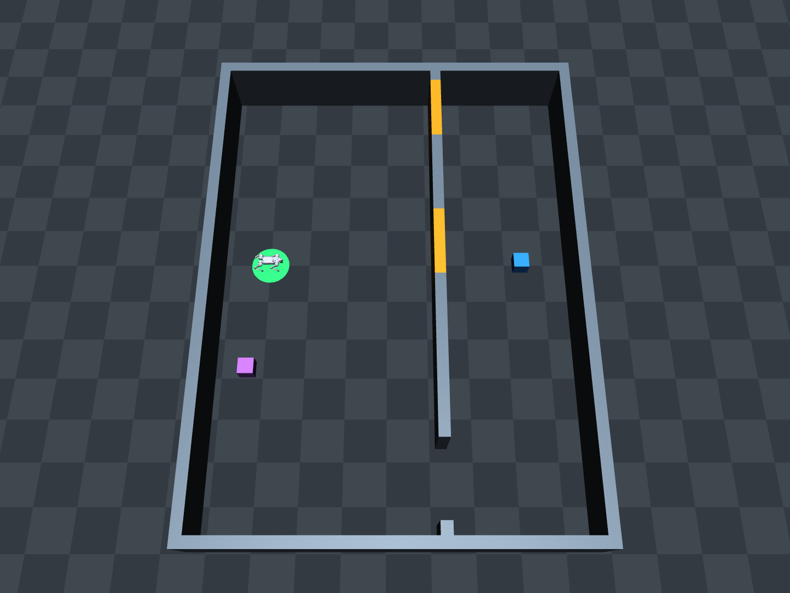

# Go2: deadline-dependent navigation with trial-persistent gates

This is the active next Go2 environment. The earlier three-cargo hidden-value
pilot and checkpoints remain in `../deadline_go2_cargo`. A new high-level
half-BC run has been launched as described below. The original single-goal scaffold and its checks
are preserved under `versions/single_goal_v1` after the user requested a
low-value fallback station.
Earlier scenes are preserved under `versions/`: the extra-screen version
and the subsequent no-screen/8m-sensor version. The active version has no
spawn-side screen, a 2 m lidar limit, and the divider shifted from x=3 to x=4.

## Task

- Green base: (0,0) m. Purple fallback loading station: (-0.35,-2.6) m,
  **known fixed value 1**. Blue far station: (6,0) m, **known fixed value 4**.
  There are no hidden/random values, payload weight differences, or danger
  regions. Both stations use identical unloaded locomotion.
- Contact within 0.45 m loads logical cargo. A higher-value station may
  upgrade cargo; lower-value contact never downgrades it. No physical cargo
  is attached. Returning within 0.45 m of the base ends the episode after
  exactly one delivery. Reward is value/4: fallback 0.25, high 1. Timeout or
  instability gives 0. No progress shaping, entry cost, or per-step reward.
- A divider at x=4 m has a middle opening y=0, an upper opening y=3.6, and
  a longer, always-open lower opening y=-5.2. Openings are 1.6 m wide.
  Middle and upper gates independently open with probability 0.5 at a new
  trial. Both states remain fixed over the trial's three episodes.
- The space between spawn and the divider is open. No extra occlusion wall
  has been reintroduced. The lidar's actual raycasting maximum is 2 m;
  nothing beyond that range creates occupied or free-space evidence. Both
  gates are outside the initial sensing range. All four patterns have
  identical initial state vectors, raw scans and projected input grids.
  Closed gates exert real contact forces; open gates move below the floor
  between trials, without changing robot contact parameters.

Current physical route checks measured 11.5 s for the fallback, 24 s through
the middle, 44 s through the upper opening, and 57.5–58 s through the lower
opening, with two initial perturbations and no contacts/falls. These are
scripted-route timings, not shortest-path or universal feasibility bounds.
Earlier layout timings should not be used for this version.

Current deadlines are **18 / 48 / 100 seconds**. They are chosen to test:

- Short: take the nearby fallback without needing to inspect gates.
- Medium: use a remembered open passage for value 4; choose fallback if
  both gates are closed. Inspection during the first episode can consume
  the time margin needed to return high-value cargo.
- Long: return value 4 using the always-open long detour, with room for
  first-episode probing in the checked demonstrations.

Current measurements are `validation/range2_wall4_routes/calibration.json`,
`validation/range2_wall4_sensors/checks.json`, and
`validation/range2_wall4_deadlines.json`. The sensor check explicitly tests
that open gates cannot be inferred from nonexistent out-of-range rays. The scripted
12-condition / 36-episode check passed without contacts or falls. At 48 s
with middle closed and upper open, the demonstrated values are 1,4,4; with
both closed the values remain 1. At 100 s even both-closed trials deliver
4,4,4 (78 s initially, then 58 s). These demonstrate one feasible history
controller; they do not prove high-value delivery is impossible for every
first-episode policy under the medium budget.

## Observation and action

`GateTrial.observe()` returns only:

- `grid`: **3 x 64 x 64** local occupancy, height, and observed-column
  projection. It comes from actual first-hit simulated lidar and a
  **12 x 64 x 64** XYZ voxel array with 0.125 m cells. It is heading-aligned,
  robot-centred, and covers XY +/-4 m and Z 0–1.5 m. Only the
  actual 2 m sensor rays populate this crop; other space remains unknown. It contains current
  local geometry, with no gate IDs or open/closed labels.
- `state`: **19 values**: relative base/fallback/high positions (6),
  sin/cos heading (2), body vx/vy (2), remaining fraction and deadline/120
  (2), carrying flag and carried value/4 (2), previous vx/vy actions (2),
  previous reward (1), episode index/2 (1), terminal flag (1). Target
  coordinates keep their independent 8 m normalization; shortening the lidar
  does not rescale the target state.

There is no global map, full obstacle list, risk annotation, privileged door
state, camera, or target-identity detector in the policy observation. Known
fixed target locations are part of the task. Pose/velocity are ideal simulator
odometry for this feasibility version. Voxelization uses current scan points
and rays, not a list of wall or gate coordinates. It is a single-scan local
map, without SLAM, persistent scan accumulation, or measurement noise.

The physical lidar pattern has 360 x 32 rays, 360-degree azimuth, elevation
[-45,+15] degrees, and 2 m range. It is a generic virtual sensor, not yet
calibrated to a particular real Go2 L1/L2 mount. It is not a decoder or direct
adapter for the real `voxel_map_compressed` binary format.

Actions are normalized body vx/vy, scaled to +/-0.6 and +/-0.4 m/s. Yaw
command is zero, matching the frozen Full_8000 checkpoint's training range;
actual heading can drift. High-level control and scan input are 2 Hz.
Locomotion remains 50 Hz, Genesis dt=0.02 s with two physics substeps. This
is a local Genesis checkpoint, not the real robot's Unitree Sport firmware.

Genesis 0.4.6 lacks a per-sensor period. The new world's instance-local
sensor-manager step is deferred and explicitly refreshed at each control
boundary/reset/door change. Only its zero-delay lidar is attached; robot
physics and low-level proprioception are unchanged. This version-specific
adapter avoids unnecessary 50 Hz raycasts while preserving current scans.

## Episode and trial API

`reset(deadline=..., doors=(True,False))` starts a new trial. `True` means
open; order is middle, upper. Omit doors/deadline to sample from the config.
`step(action)` returns `(observation, reward, episode_done, info)`.
After an episode ends, call `next_episode()` to reset motion/time/cargo while
retaining gate states. The third end sets `info['trial_done']`; calling
`next_episode()` then raises. A new trial requires `reset()` and clearing
the high-level policy's memory. Model memory is owned by the trainer,
not implicitly stored in this environment.

`simulation.step_batch` advances a shared physical world once. A batched
trainer should wait for all members to finish an episode before calling
`next_episode()` for the next one, as the demo does. Checkpoint inputs differ
from the earlier 24D three-cargo task and must not be loaded unchanged.

## Preview and physical demonstration

Static MuJoCo preview of the same metric geometry (no locomotion implied):

```bash
/home/yufeng.yang/Downloads/enter/envs/time_adapt/bin/python /home/yufeng.yang/codespace/time_adaptation/deadline_go2_gates/test0.py
```

Press **1 / 2** to toggle middle/upper gates, **]** for the virtual head
camera, **Esc** for free view. Mouse drag changes the view. `--doors 01`
means middle closed, upper open. `--save /tmp/go2_gates.png` saves an image
instead of opening a window (`MUJOCO_GL=egl` for headless rendering).

Publication screenshots are in `figures/environment4_lidar_range_*` (clean
PNG, text-free PNG/PDF/SVG, and coordinate/range metadata). Run
`MUJOCO_GL=egl .../bin/python render_paper.py` to regenerate them. The cyan
dashed 2 m horizontal visibility illustration is centred on the lidar's actual
0.30 m forward mount offset. Both fill and outline stop before the first wall;
this schematic is separate from the policy's actual 3D lidar input. The latest
landscape export uses a mild eight-degree camera tilt with tightly cropped margins.
The nearest gate surfaces are 3.575 m and 4.541 m away, both beyond 2 m.
Figure gate numbers follow the user's top-to-bottom ordering: upper is
Gate 1, middle is Gate 2. The goal is behind Gate 2 at (6,0), matching the
training configuration. Preview overrides and annotations do not change
training, collisions, or policy observations.

Actual Genesis locomotion with a diagnostic history controller:

```bash
/home/yufeng.yang/Downloads/enter/envs/genesis/bin/python /home/yufeng.yang/codespace/time_adaptation/deadline_go2_gates/demo.py --doors 01 --deadline 48 --viewer --output /tmp/go2_gate_trial.json
```

The hand-specified controller uses known static waypoint geometry, observes
gate states only from local first-hit rays, and keeps those observations
across episodes. It uses conservative calibrated timing priors to choose a
fallback. It is a feasibility/demo controller, not a trained agent or a
planner that generalizes to new layouts. Its internal coordinates/labels
are not added to the policy input.

## Checks

`test_environment.py` checks state secrecy, pickup/return/one-delivery reward,
fallback reward, no cargo downgrade, timeouts, invalid inputs, and task
persistence over three episodes. `validate_sensors.py` checks actual initial
gate invisibility and nearby visibility, local open/closed evidence, cache/reset consistency, and intentional
physical blocking by closed gates. `calibrate.py` measures clean physical
route times. `validate_deadlines.py` checks all four patterns at all three
deadlines, including intended value/strategy differences across budgets and episodes.
All output entries refuse to overwrite existing validation files.

No SDK/hardware is accessed by these scripts.

## High-level half-BC training

Active run: `runs/half_bc_steps100k_seed0`; log: `runs/half_bc_steps100k_seed0.log`.
This is a newly launched training run; its existence does not imply convergence.

The policy is a 3-channel CNN, 2-layer causal Transformer (width 64), and a
64-unit GRU updated only at completed episode boundaries. It receives the
19D state and current local sensor grid. GRU state resets at each new trial.
The same frozen unloaded locomotion checkpoint is used throughout.

There are **200 supervised BC warmstart optimizer updates**, followed by
**100,000 active high-level environment transitions** of PPO. The BC action
MSE coefficient during PPO is `beta(s) = max(0, 1 - s/80000)`. Thus it starts
at **1**, reaches **0 at 80k steps**, and stays zero for the remaining training.
One coefficient is sampled at each rollout's start. PPO's coefficient remains
1: the total is PPO loss plus beta times BC action MSE. This is loss-weight
annealing; optimizer weight decay is zero. Warmstart additionally trains the
critic with coefficient 0.05.

Each counted transition is one active **2 Hz high-level action** in one
environment, summed over 12 parallel trials and all three episodes. Demonstration
collection, supervised replay, evaluation, inactive batch members, and 50 Hz
locomotion steps do not increment this counter. Complete trial batches may
slightly overshoot the total-step budget. PPO updates and environment steps
are reported separately; they are not interchangeable.

The objective is the undiscounted sum of three episode rewards. Checkpoint
selection uses mean **third-episode delivered value** over all four gate patterns
at all three deadlines, with fresh simulator initialization seeds. This is
seen-pattern, fixed-layout feasibility training, not unseen-layout validation.
Teacher demonstrations use fixed hand-specified route geometry and acquire
gate states from actual local rays; gate labels are never policy inputs.

The short starts `runs/half_bc_seed0` and `runs/half_bc_from1_seed0` were stopped
before parameter training while correcting the BC coefficient and its timebase.
Their status files distinguish them from active training. Earlier archived
experiments keep their original settings and weights: the final navigation
archive used 500k steps with BC decaying to **0.1**, while the earlier 100k
navigation pilot decayed from 1 to 0 by 80k. The pick-place archive used a
0.2 auxiliary coefficient; it was not retroactively changed to 1.

```bash
/home/yufeng.yang/Downloads/enter/envs/genesis/bin/python /home/yufeng.yang/codespace/time_adaptation/deadline_go2_gates/train.py --output /tmp/go2_half_bc_run --device cuda --bc-updates 200 --total-steps 100000 --bc-decay-steps 80000 --bc-initial-weight 1
```

After validation records exist, `plot_training.py RUN_DIRECTORY` plots the
recorded BC loss and third-episode validation values. `test_training.py` checks
causal attention, matching rollout/replay action densities, gradients through
cross-episode memory, trial return targets, and the step-based BC schedule.


