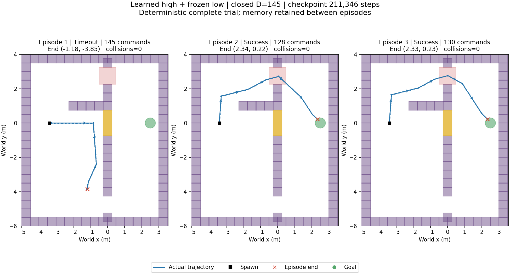
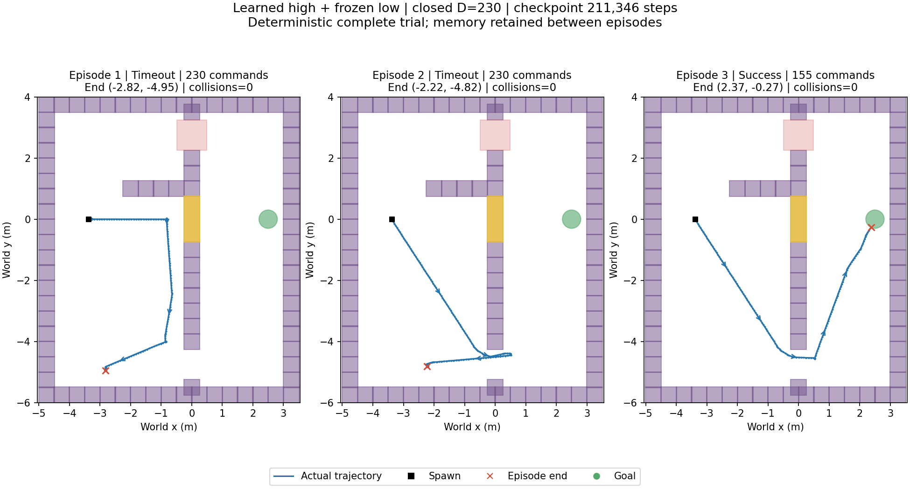

# final_experiment_2

本目录保存用户确认的版本：**211,346 步的最好高层模型**，配合冻结底层执行。选定版本的确定性 trial 第三局评估为 **5/6**；五个可行场景全部成功，唯一失败场景为仅保留评估的 closed D=75。这是固定地图、固定评估流程的结果，不代表随机地图或多种扰动下的成功率。

## 选定模型与结果

- `best_model.pt`：本版本应使用的高层检查点，211,346 步，与原 best 模型逐字节一致。
- `frozen_low_actor.pt`：本版本使用的冻结底层；高层三个动作分别为左转、直行、右转，每条指令 0.2 秒。
- `best_evaluation.json`：选定模型全部 18 局的原始评估记录。
- `config.json`：原始训练配置，保留其中的原目录路径作为溯源信息。
- `experiment.json`：归档名称、来源、选定检查点、文件校验值和 closed 三局结果。

Closed D=145：第一局探门后向下走，145 步超时；第二、三局走上路，分别 128、130 步成功。三局均零碰撞。

Closed D=230：前两局在下方区域走偏，均 230 步超时；第三局从出生点斜向下路入口，155 步成功。三局均零碰撞。





两个 `paths/` 子目录同时保存逐步位置、动作和三局评估数据；已核对其结果与选定 best 评估一致。

## 冻结的实验设置

- 地图向左扩宽，出生点 (-3.375, 0)，初始朝向朝右；deadlines 为 75/145/230。
- 输入 63 维：身体传感器、goal/wall/door 各 16 维雷达、绝对 xy、剩余步数/50。**没有 danger 雷达输入**。
- 仅 D=145 第一局首次进入 danger 给 +0.02；该场景第二/三局以及 D=230 全部三局首次进入 danger 均扣 0.2。每局只触发一次。
- 三局 PPO 奖励权重 0.2/0.5/1；跨局记忆在完整 episode 结束后更新，trial 开始清零。
- BC 转向步骤及前后 2 步权重 5，其余步骤权重 1，按总权重归一化；20 次 BC 热身，400k 步退火至 0.1。
- closed D=75 同时从 PPO 和 BC 中排除，但仍保留评估。

## 复现与完整训练记录

`training_run/` 是已完成 500,286 步训练的完整副本，含训练曲线、所有已保存的评估、原始代码快照以及 initial/bc/best/latest/final 模型。**其中最后一步的 final 模型为 4/6，本目录选定的是 5/6 的 best 模型。**

`runtime_source/` 以当时的原始代码快照为基础，补齐本地导入依赖，并加入空的包初始化文件，使回放不会回退到项目中以后修改的代码。原始快照保存在 `training_run/source_snapshot/`，内容未修改。

使用现有 sb3sg 环境可从任意工作目录运行：

```bash
/home/yufeng.yang/Downloads/enter/envs/sb3sg/bin/python /home/yufeng.yang/codespace/time_adaptation/final_experiment_2/replay.py
```

回放使用归档中的高层、底层和代码，先按原训练流程用 seed=100000 初始化固定场景缓存，再用 seed=20000 重新执行全部六个 trial，并核对全部 18 局与保存评估一致。已从项目外的工作目录独立验证通过，结果保存在 `replay_verification.json`。可通过 `--output /path/to/evaluation.json` 保存结果。依赖版本见 `runtime_versions.json`；此目录不包含 Python 环境本身。

`checksums.json` 保存归档文件的 SHA-256。原训练目录和已生成的原路径图均保留。
