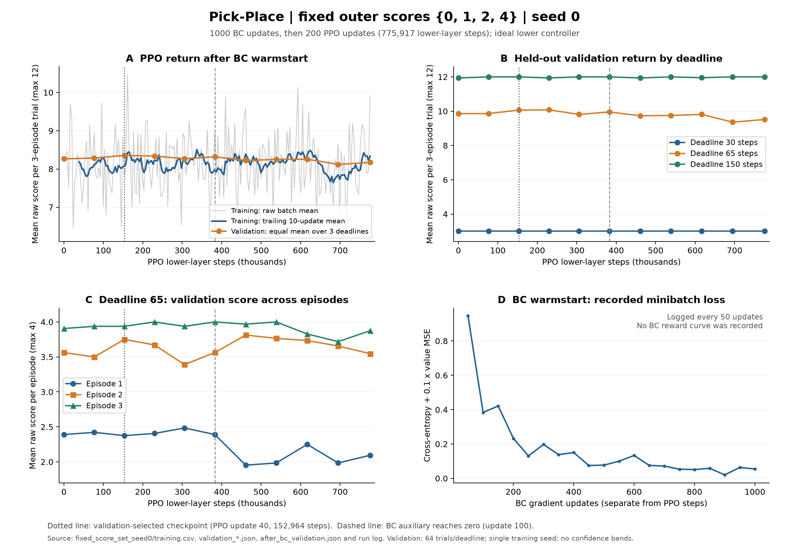
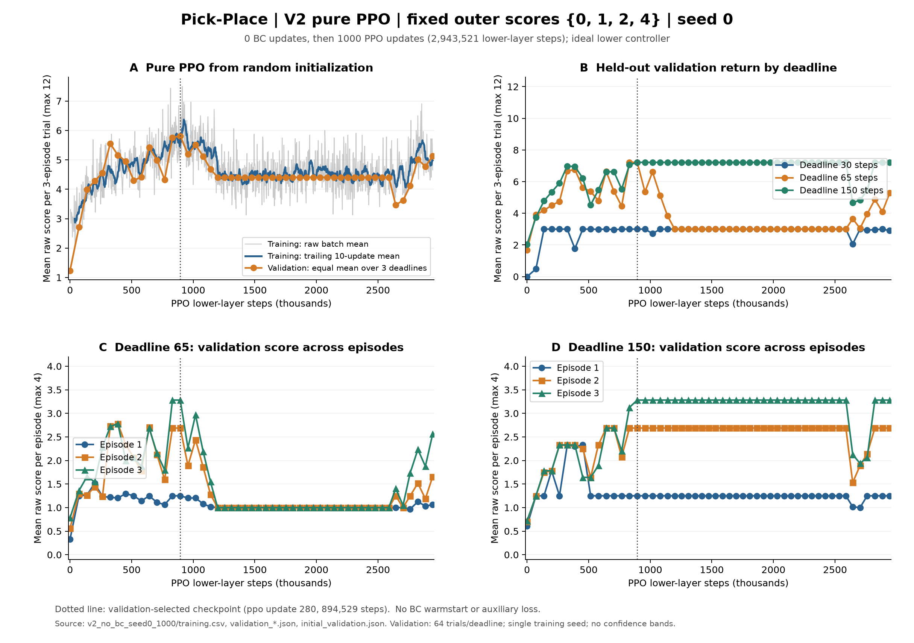

# 实验 3：Deadline Pick-Place

保存日期：2026-10-26。用户确认以半 BC 版本作为当前采用版本，同时保留无 BC 的版本二。
编号沿用项目现有的 `final_experiment_2`（导航实验）；本目录为机械臂实验 3。

## 当前采用模型

推荐权重：[`half_bc/best.pt`](half_bc/best.pt)，1000 次 BC 热身后，验证集选出的
第 40 次 PPO 更新模型。半 BC 全程完成 200 次 PPO 更新，前半程含退火的 BC
辅助项，后半程该项为零。`half_bc/final.pt` 是第 200 次更新的最终权重。

无 BC 对照：[`pure_ppo/best.pt`](pure_ppo/best.pt)，总计 1000 次更新中验证集
选出的第 280 次更新模型；`pure_ppo/final.pt` 是第 1000 次更新模型。
无 BC 版本从随机初始化训练，随后从第 200 次继续到 1000 次；训练中没有示范、
BC 热身或 BC 辅助项。原第 200 次旧检查点缺少随机状态，续训保留模型与 Adam，
采样改用可复现种子 200；相应审计在 `pure_ppo/resume_audit.json`。

## 任务与适用范围

- Panda 场景：中央盘子；近球 S 距中心 18 cm，固定 1 分；四个外球距中心 36 cm。
- 外球 A/B/C/D 每 trial 恰好对应 `{0,1,2,4}` 的随机排列，接触后才揭示价值。
- 每个 trial 三局共享布局、分值与 deadline；每局重置位置与时间，GRU 跨局保留。
- 49 维观测；九个上层动作（检查四个外球、取回五个球）。
- 两层宽度 64、四头的局内因果 Transformer，加 64 维跨局 GRU。
- 成功送回一个球立即结束本局；奖励为原始分值 / 4，其他奖励为零。
- 训练使用三局累计回报、gamma=1；deadline 为 30/65/150。

**这里保存的是使用固定速度理想执行器的上层可行性实验。** 它共享 MuJoCo
场景布局，但训练与动画不模拟机械臂关节、碰撞和真实抓取。真实下层尚未训练，
接入后仍需重新测量耗时与标定 deadline。结果来自单个训练种子。

## 配对独立测试结果

每个 deadline 128 个 trial；三个 deadline 使用配对布局和分值，
两版方法也使用相同测试任务。最佳权重只按验证集选择。
以下均为三局平均原始总分，最高 12 分：

- 半 BC best：30 步 3.000，65 步 9.891，150 步 12.000。
- 半 BC final：30 步 3.000，65 步 9.773，150 步 11.938。
- 无 BC best：30 步 3.000，65 步 7.133，150 步 7.133。
- 无 BC final：30 步 2.922，65 步 5.586，150 步 7.133。

原始精确数值、每局成绩及完整测试动作见各版本的 `test_results.json` 与
`test_trials.json`。两组训练预算不同，不将本次比较作为多种子或等预算结论。





## 归档内容

- `half_bc/`：选定半 BC 训练的完整结果，含各阶段权重、曲线、配置、测试与源码快照。
- `pure_ppo/`：无 BC 续训至 1000 次的结果，含前 200 次的曲线与验证历史、恢复审计及动画。
- `runtime_source/`：冻结的环境、模型、训练、评估、绘图、动画和物理场景代码。
- `replay.py`：仅使用本目录模型与代码的独立评估或单 trial 动画入口。
- `experiment.json`：版本选择、原始来源和结果索引。
- `checksums.json`：文件 SHA-256；`replay_verification.json`：独立回放核对结果。
- `runtime_versions.json`：生成与回放所用 Python 依赖版本；不包含安装环境本身。

只归档这两个采用/对照版本。早期 smoke、旧独立抽分实验，以及被替代的
初测仍在原 `deadline_pick_place/high_level/runs/`，未删除，也未混入本目录。
原配置中记录的历史绝对路径保留作溯源；独立回放不使用这些路径。

## 独立回放

可从任意工作目录使用已有 `time_adapt` Python：

```bash
/home/yufeng.yang/Downloads/enter/envs/time_adapt/bin/python -B \
  /home/yufeng.yang/codespace/time_adaptation/final_experiment_3/replay.py
```

默认重评半 BC best 的全部 384 个 trial，并核对归档测试结果。
用 `--variant pure_ppo` 查看无 BC，用 `--checkpoint final` 查看最终权重。
渲染一个完整三局 trial：

```bash
/home/yufeng.yang/Downloads/enter/envs/time_adapt/bin/python -B \
  /home/yufeng.yang/codespace/time_adaptation/final_experiment_3/replay.py \
  --variant half_bc --render --deadline 150 --seed 300000
```

渲染使用理想执行器的俯视轨迹，生成 MP4/GIF，不打开机械臂窗口。
