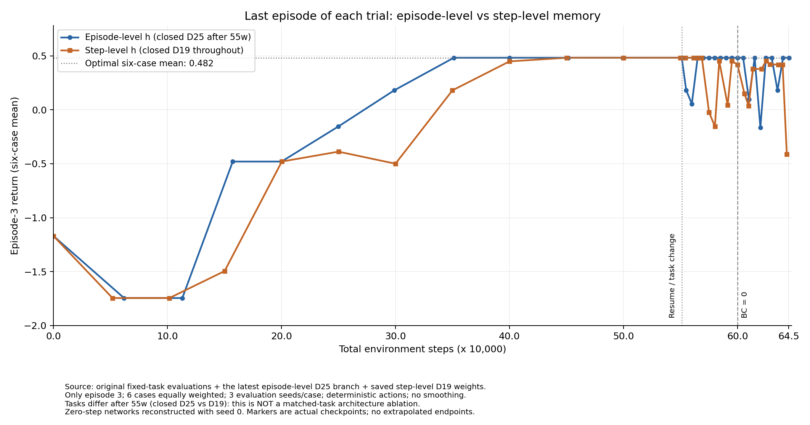

# 离散 Meta-RL：0–64.5 万步整理版

当前展示范围固定为 **0–64.5 万环境步**，只统计每个 trial 的第三局
未折扣 return，对六种任务等权平均，每个任务使用三个确定性评估 seed。
曲线不平滑、不补造端点。名义 64.5 万附近的实际保存点：episode-level
645145 步，step-level 643351 步。



## 目录

- `third_episode_return.png` / `.pdf`：当前正式曲线。
- `curves.json` / `curves.csv`：逐点回报及相对路径来源。
- `evaluations/`：图中所有点对应的完整三局评估记录。
- `training_logs/`：初始训练与续训日志，分别截取到保留的检查点。
- `models/`：两种结构各自的约 55 万步模型，以及本图末端模型；包含 Adam 状态。
- `manifest.json`：保留范围、环境版本、文件 SHA256 和来源说明。
- `reproduce.py`：重新绘图、复测模型、从约 55 万步续训。

本结果包不包含 64.5 万步之后的训练。零步没有保存的旧模型，因此复用原 seed=0
重建网络的评估记录；其他点均来自实际保存的检查点。

## 训练机制

每个 trial 三局，门状态和 deadline 固定；每局重置位置与计时。
新 trial 的 h 清零，局间继承 h。episode-level 仅在局末更新 h，step-level
在每次真实转移后更新 h，包含终止转移。

每次 PPO 更新收集四个 trial：开门、关门各两个，顺序打乱；每个 trial 随机
等概率选择对应 deadline。三局环境奖励相同，完整 trial 反向传播。
PPO 加退火 BC，权重在累计 60 万步归零，不额外 BC 热身。

初始阶段两版都是开/关门 × D={15,17,19}。约 55 万步后，episode-level
续训仅将关门 D19 替换为 D25，开门仍为 D15/17/19；BC 专家与评估同步替换。
step-level 继续使用原六任务。此任务设置记录在每个评估文件和曲线元数据中。

续训恢复网络、Adam、累计步数与 trial 计数，不重启课程或 BC。
原 55 万步模型无随机状态快照，使用续训 seed=20261011；新模型保存随机状态。
这是一对训练种子的实验结果。

## 使用

在仓库根目录运行。依赖版本见 `requirements.txt`；原运行环境的实际版本也记录
在 `manifest.json`。本次整理没有安装或修改任何环境。

```bash
# 在已准备好的环境重新绘制同一份数据，输出到 generated/
python tidyup_plan2/baseline3_gate_meta_rl/release_0_64p5w/reproduce.py plot

# 校验结果包、复测两个末端模型，并与保存的逐局评估对照
python tidyup_plan2/baseline3_gate_meta_rl/release_0_64p5w/reproduce.py verify

# 从约55万步继续到约64.5万步；不会覆盖已有 runs/ 中的数据
python tidyup_plan2/baseline3_gate_meta_rl/release_0_64p5w/reproduce.py train --mode episode
python tidyup_plan2/baseline3_gate_meta_rl/release_0_64p5w/reproduce.py train --mode step

# 运行协议及结果包测试
python -m unittest tidyup_plan2.baseline3_gate_meta_rl.test_trial_protocol tidyup_plan2.baseline3_gate_meta_rl.ablation_stepwise_h.test_protocol tidyup_plan2.baseline3_gate_meta_rl.release_0_64p5w.test_release
```

episode-level 的 55 万步模型在关门 D19/D25 后两局均能走 18 步安全绕路。
本图末端的 episode-level 在关门 D25 第三局仍为 18 步安全绕路、return 0.82。
图是六任务平均值，不等于单一关门条件的回报。

统一续训入口也可使用 `../train_final.py --mode episode` 或 `--mode step`。
基础实现分别为 `../train_decay_bc.py` 与 `../ablation_stepwise_h/train.py`；
它们提供从头训练至约 55 万步的第一阶段。重新绘图不需要历史目录、机器特定绝对路径或 Git 元数据。

旧方案、重复脚本及完整中间训练目录已从活动代码目录移走，不作为最终方案保留。
